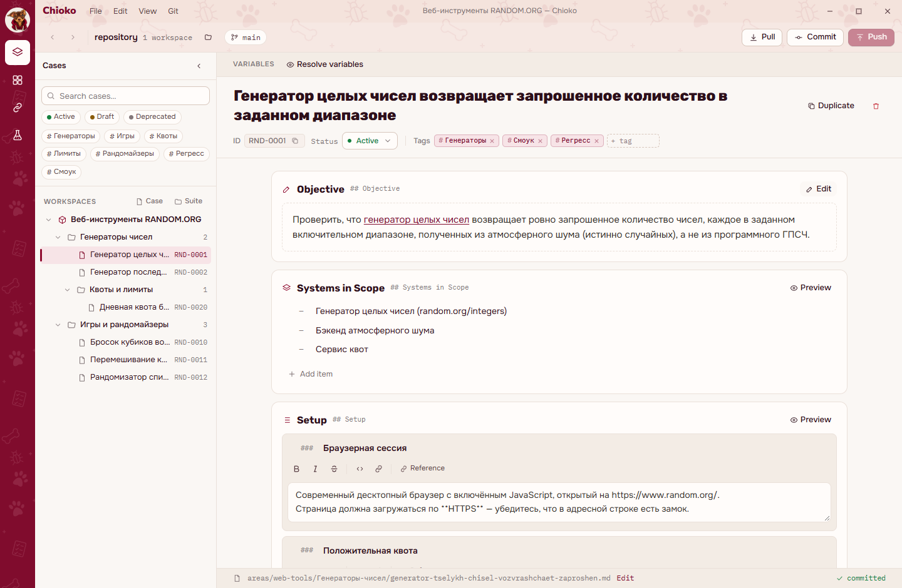

<p align="center">
  
</p>

<h1 align="center">Chioko</h1>

<p align="center">
  Тест-кейсы, ручные прогоны и автотесты в одном desktop-приложении.<br />
  Markdown для данных. Git для истории. Понятный интерфейс для ежедневной работы QA.
</p>

<p align="center">
  <a href="LICENSE"></a>
  
  
</p>

<p align="center">
  <a href="#возможности">Возможности</a> ·
  <a href="#начать-работу">Начать работу</a> ·
  <a href="#разработка">Разработка</a> ·
  <a href="#благодарности">Благодарности</a>
</p>

**Chioko** помогает вести тестовую документацию, выполнять проверки и разбирать
результаты в одном проекте. Кейсы остаются обычными файлами: их можно читать,
редактировать в IDE и использовать в работе с агентом. История изменений хранится
в Git, а синхронизацию с удалённым репозиторием можно подключить позже.

Chioko — форк [Casewright](https://github.com/jimbuck/casewright), созданного
[Jim Buck](https://github.com/jimbuck), с собственным интерфейсом и развитием
сценариев работы с кейсами, справочником и автотестами.



*На скриншоте — демонстрационные данные.*

## Возможности

| Раздел | Что можно делать |
| --- | --- |
| **Cases** | Создавать кейсы с описанием, предусловиями, шагами и ожидаемыми результатами; группировать их по папкам и workspace, задавать статусы и теги. |
| **Runs** | Собирать прогоны, фиксировать результаты проверок, фильтровать кейсы по статусам и смотреть активность по дням и годам. |
| **Reference** | Хранить ссылки, описания и наборы аргументов для разных окружений; вставлять записи в кейсы и читать их через карточки. |
| **Autotests** | Просматривать тесты в структуре исходных файлов, связывать несколько автотестов с одним кейсом и выбирать аргументы из справочника. |

- **Запуск и разбор автотестов:** отдельный тест, все выбранные или проваленные; результат и вывод по каждому тесту, включая повторные попытки.
- **Баг-репорты:** черновик на основе кейса и результатов прогона, редактирование фактического результата и добавление доказательств.
- **Отчёты:** предпросмотр и экспорт в PDF с оформлением Chioko.
- **Git:** локальная история, просмотр изменений, коммиты, Pull и Push.
- **Навигация:** переходы назад и вперёд, быстрый доступ к модулям и открытие папки репозитория.

Интерфейс использует светлые поверхности, бордовый акцент и шрифты Onest, Rubik
и Nunito Sans. Шрифты включены в приложение и PDF-экспорт.

## Начать работу

### Готовая Windows-сборка

1. Распакуйте ZIP-архив целиком и запустите **Chioko.exe**. Папка `git/` и остальные файлы должны оставаться рядом с приложением: Git уже включён в поставку.
2. Выберите **Создать проект**, укажите название и папку. Chioko подготовит локальный Git-репозиторий, настройки `.ch` и первый workspace.
3. Создайте первый тест-кейс, затем добавьте его в прогон и запишите результат проверки.

Чтобы продолжить работу с существующей папкой, нажмите **Открыть проект**.
Если в ней ещё нет настроек Chioko, приложение предложит добавить их, сохранив
имеющиеся документы. Недавние проекты доступны на стартовом экране;
вернуться к нему можно через **File → Projects…**.

Для работы с ручными кейсами GitHub и командная строка не требуются.
Для настоящего запуска автотестов нужны Node.js 22+, зависимости Playwright
в тестовом проекте и установленный браузер Playwright.

## Как хранятся данные

**Проект** — корневая папка репозитория. **Workspace** — область тестирования
внутри проекта, например «Витрина», «Личный кабинет» или «API».
Для начала достаточно одного workspace, который создаётся автоматически.

Chioko поддерживает хранение кейсов внутри `.ch/areas`. Пример компактной структуры:

```text
my-project/
├── .git/                  # история Git всего проекта
└── .ch/
    ├── config.yaml        # настройки и список workspace
    ├── areas/
    │   └── web-tools/     # workspace: папки и Markdown-кейсы
    ├── runs/              # прогоны и результаты
    ├── glossary/          # справочник и наборы аргументов
    ├── autotests/         # проект Playwright
    ├── automation/        # связи с кейсами и результаты автотестов
    └── defects/           # сохранённые баг-репорты и вложения
```

Пути workspace задаются в `.ch/config.yaml`: они также могут находиться
в корне проекта или в других его папках. `.git` остаётся в корне репозитория.

Для переноса данных предыдущей версии в `.ch` доступна команда:

```powershell
cd app/apps/desktop
pnpm migrate:chioko D:\path\to\test-repository
```

Подробности формата и рабочих сценариев — в [документации desktop-приложения](app/apps/desktop/README.md).

## Разработка

Нужны **Node.js 22+**, **pnpm 11+** и **Git**.

```powershell
cd app
pnpm install
pnpm dev:desktop
```

Откроется настоящее desktop-окно с обновлением при изменении исходников.
Терминал с dev-сервером должен оставаться запущенным.

Для HTTP-предпросмотра с временными демоданными:

```powershell
cd app/apps/desktop
pnpm dev:mockup
```

Проверки и сборка из папки `app`:

```powershell
pnpm --filter @chioko/desktop typecheck
pnpm --filter @chioko/desktop test
pnpm --filter @chioko/desktop build
pnpm --filter @chioko/desktop package:win
```

Браузерные проверки компонентов:

```powershell
cd apps/desktop
pnpm exec playwright install chromium
pnpm test:ui
```

Основа приложения — **React + TypeScript + NW.js**, сборка — **Vite**,
монорепозиторий — **pnpm workspaces**. Общие цвета, шрифты и графика находятся
в [`app/packages/brand`](app/packages/brand).

## Благодарности

Особая благодарность **[Jim Buck](https://github.com/jimbuck)** — создателю
**[Casewright](https://github.com/jimbuck/casewright)**.

**Chioko является форком его приложения.** Спасибо за оригинальный проект,
исходный код и основу для дальнейшего развития инструмента. Мы сохраняем
указание авторства и уведомление об авторских правах оригинального Casewright.

## Лицензия

Код Chioko распространяется по [лицензии MIT](LICENSE). В ней сохранено
авторское уведомление Jim Buck и добавлено уведомление для изменений Chioko.

Шрифты поставляются со своими [лицензиями SIL Open Font License](app/packages/brand/fonts).
Сторонние компоненты, включая поставляемый Git, сохраняют собственные лицензии.
