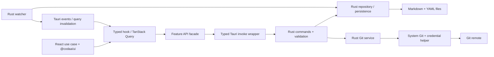

# Архитектура Tauri 2

Основа Tauri 2 выбрана пользователем; детали реализации — проект. [ADR-0001](adr/0001-desktop-stack.md).

## Границы

| Слой | Владеет | Контракт |
| --- | --- | --- |
| React WebView | Сценарии, draft, selection, queries, i18n | Serializable DTO, без fs/process/credentials |
| Invoke facade | Конкретные commands и typed errors | openRepository/listCases/saveCase/gitStatus, без generic shell API |
| Rust command layer | Session/window/payload validation | serde DTO, command permissions, typed Result |
| Rust services/domain | IO, format parsing, watcher, Git queue, recents | Pure domain и service tests, без React |
| UI Kit | Примитивы и tokens | @codaa/ui public exports |

## IPC и permissions

Folder picker — native Tauri dialog с минимальными permissions. Rust возвращает opaque repo session id; React не передаёт произвольный абсолютный repo root.
Command handlers проверяют window/webview, payload, session, repo-relative paths и canonical/symlink targets. Input structs десериализуются в serde DTO и валидируются по бизнес-правилам; ошибки и результаты имеют соответствующие TS types/runtime schemas.
Параметр типа invoke не проверяет входящий JSON автоматически: checks на обеих сторонах обязательны.

Явно объявить custom commands в AppManifest и создать allow permissions/capabilities только для доверенного окна. По умолчанию custom app commands доступны всем app windows/webviews; одних plugin permissions недостаточно. Remote API access не включается.
Ни filesystem wildcard, ни arbitrary shell execution из WebView не требуются для repo API. Node runtime и sidecar отсутствуют.

Долгие Git/IO операции выполняются вне UI thread, имеют cancellation/timeout. Tauri events содержат только необходимые DTO, frontend subscriptions очищаются.

## State и persistence

TanStack Query — repo snapshots/invalidation; Zustand — selection/panels/settings; editor draft — use-case hook. HTTP backend ради этих сценариев не создаётся.
Rust управляет repo session и single-repo operation queue. Atomic writer пишет temp рядом с target и rename; close/commit ждут flush, errors сохраняют draft.
Rust watcher фильтрует self-writes. Clean entities reload; dirty draft при внешнем изменении требует решения пользователя.

## Git

Rust service запускает системный Git executable с фиксированным repo cwd и массивом аргументов, без shell interpolation. Команды, filenames, output limits, timeout/cancellation и credential errors проверяются сервисом.
Credentials получают системный helper/SSH; Git2/libgit2 и simple-git runtime не нужны. Foreign staged files не коммитятся молча.
OS Git hooks/config требуют политики доверия: capabilities WebView её не заменяют. Текущий ограниченный commit slice отклоняет active hooks/core.hooksPath, signing и выбранные файлы с external filters, вместо исполнения или молчаливого обхода. Для таких repos используется внешний Git; полная trust model остаётся открытой. Алгоритм temporary index, recovery и ограничения: [Git evidence](../apps/desktop/evidence/git-inspection.md).

При конфликте приложение сообщает об ошибке и показывает unmerged paths; пользователь может явно запросить безопасный abort текущей операции. Приложение не разрешает конфликт и не предоставляет отдельный запуск/проверку внешнего редактора. Если abort невозможен, Git flow блокируется с диагностикой; автоматические reset/clean/force и обещание безусловного восстановления исключены.

## WebView и security

Production CSP, запрет произвольной навигации/remote privileges, ограниченные dialog/opener capabilities. HTML/scripts в Markdown не исполняются. Paths/URL schemes проверяются перед OS APIs.
Windows WebView2 и macOS WKWebView проверяются отдельно: одинаковый browser preview не доказывает одинаковое native поведение.
Security controls — Tauri command permissions/capabilities и Rust validation; Electron preload/contextIsolation settings здесь не применяются.

## First vertical slice

Tauri window + React/Vite/Kit → typed command → Rust read-only load → tree/case; сравнить hashes до/после открытия. Затем один Rust writer → flush → reopen → diff и parity tests. Остальные CRUD/runs/Git — следующие срезы.

### Rust read-only repository foundation

`services::repository::RepositoryService` открывает выбранный через native folder picker каталог, проверяет Git worktree root и возвращает сериализуемые display/workspace metadata с opaque UUIDv4 session token. Канонический root остаётся private backend state. `read_text` — внутренний метод: он принимает только repo-relative path, ограничивает чтение 2 MiB, требует UTF-8 и проверяет canonical target внутри root; Git metadata (`.git`) недоступна через этот API. Читаются только обычные файлы; canonical-проверка не устраняет TOCTOU race с внешним изменением путей, поэтому это foundation, не OS-level filesystem sandbox. Registry переиспользует один активный token для того же canonical root, `close` инвалидирует token. Типизированные IPC-команды валидируют main window/origin, протокол и token/resource membership перед работой; filesystem/Git действия исполняются в `spawn_blocking`. Произвольного абсолютного пути или общего file-read IPC нет. Отсутствие config возвращает `needsInitialization`; `.casewright/` не создаётся. Legacy layout, повреждённый config и версии вне 1/2 диагностируются без migration. Это foundation, а не законченный repository load.

Read-only catalog service перечисляет объявленные workspaces, folder notes и Markdown cases, регистрирует opaque resource IDs и typed reads. Отдельные методы catalog/read обслуживают `.casewright/runs` metadata и только обнаруженные sidecars. Общие пределы обхода: 20 000 entries, depth 64 и 32 MiB прочитанных данных; per-file limits описаны в `apps/desktop/README.md`. Команды уже подключены к native IPC, но UI пока их не вызывает. Mutex registry удерживается во время чтения; cancellation/close конкурирующей операции ещё не реализованы. Без `.order` порядок детерминирован lower-case + исходное имя и может отличаться от JS locale collation для non-ASCII имён. Диалог реализован через Rust API `tauri-plugin-dialog` без frontend plugin permissions: [официальная документация](https://v2.tauri.app/plugin/dialog/).

`services::recents::RecentRepositoryStore` хранит не более 20 canonical repo paths и UI-safe DTO (`recentId`, `displayName`, `lastOpenedAtMs`) в `recent-repositories.json` внутри Tauri app-data каталога; JSON версии 1 ограничен 64 KiB, отображаемое имя обрезается на границе UTF-8 до 512 bytes. Private entry может содержать `lastWorkspacePath` — только нормализованный declared relative path (до 1024 UTF-8 bytes), без абсолютного пути. Отсутствующее поле в старом JSON v1 читается как unset. Вызовы `list_recent_repositories`, `open_recent_repository` и `remember_workspace` ограничены main capability; WebView передаёт только протокол, opaque IDs и объявленный workspace path. Перед записью `remember_workspace` сервис повторно проверяет session, declaration и directory scope; app-data внутри выбранного repo отклоняется. Picker/recent open возвращает `preferredWorkspacePath` только после проверки доступности среди объявленных workspaces; если preference исчезла, выбирается первая доступная область, а история при чтении не меняется. Открытие обновляет историю best-effort только после успешного открытия; сбой выдаёт безопасное предупреждение/ошибку, но не отменяет открытие или локальный выбор области. Конструктор и чтение не создают каталог; запись атомарно публикует файл через tempfile в том же каталоге. Повреждённая/неподдерживаемая история не перезаписывается; отсутствующий repo остаётся в списке с ошибкой при разрешении. UI списка/открытия недавних и сохранения workspace вызывает типизированный IPC; app-data store не является writer для Casewright, а гонки с внешней заменой его пути не заявлены как OS-level sandbox.

На Windows системный Git запускается без консольного окна посредством `CREATE_NO_WINDOW` (значение `0x08000000`); это флаг Win32 создания процесса, не изменение глобальной конфигурации: [Microsoft process creation flags](https://learn.microsoft.com/en-us/windows/win32/procthread/process-creation-flags).

## Primary sources

[Tauri commands](https://v2.tauri.app/develop/calling-rust/), [capabilities](https://v2.tauri.app/security/capabilities/), [Vite/WebView configuration](https://v2.tauri.app/start/frontend/vite/).

## Case editing and explicit initialization

`read_case` возвращает SHA256 revision исходных UTF-8 bytes. `save_case` получает opaque session/resource IDs, expected revision и strict `CaseEdit` без ID и пути. Service mutex сериализует запись с чтением и close; изменяются только явно отличающиеся known fields в source-backed `CaseDocument`. После сериализации документ повторно парсится. Перед публикацией revision проверяется повторно; Git index и run snapshots не затрагиваются.

На Windows writer удерживает directory handles без DELETE sharing и с OPEN_REPARSE_POINT, создаёт temporary file в том же parent с owner/group/DACL исходника уже при создании, записывает содержимое, sync и атомарно заменяет файл. Win32 wrapper изолирован в `atomic/security.rs`; неподдержанные permissions дают отказ до публикации. Unix implementation использует rustix directory handles/NOFOLLOW, относительные openat/renameat и сохраняет mode bits; macOS build/runtime, extended ACL/xattrs и crash durability ещё не проверены. Это optimistic revision check, а не транзакция с произвольным внешним редактором в последнюю наносекунду перед rename.

Frontend editor хранит draft в useZodForm. Save single-flight, навигация и выход блокируются при dirty/pending; native close request предлагает сохранить и выйти/вернуться/явно выйти без сохранения. Save-and-exit вызывает destroy только после успешного save; ошибки записи или закрытия показываются и оставляют приложение открытым. Действующий save сначала завершается. Выбранный файл проверяется через Rust read API каждые 2 секунды: clean версия обновляется, dirty draft удерживается до явного discard/reload. Полноценный backend watcher, write queue/flush для нескольких ресурсов, recovery после crash и native close E2E остаются в задаче 3.1.

`initialize_repository` повторно проверяет Git root и отсутствие metadata, строит config v1 с root workspace, `.gitignore` для cache и `runs/.gitkeep` в принадлежащем приложению staging directory. Каталог публикуется без замены существующей `.casewright`; UI до вызова показывает список файлов. Это не миграция существующих metadata.

Поиск кейсов работает по title/displayId и status/tag текущего workspace catalog, без нового IPC-чтения. Родительские папки совпавших кейсов и исходный порядок сохраняются. Изменение фильтров не сбрасывает открытый документ или draft.

## Case creation and organization

`create_case` назначает UUID и displayId с унаследованным prefix после bounded scan. Copy строится из исходного frontmatter/body с изменением identity в отдельном документе; редактор существующего кейса ID по-прежнему не меняет. `organize_case` — strict move/delete union с expected revision и registered resources. Только declared workspace и catalogued folders; canonical targets проверяются заново. Service mutex сериализует операции.

Windows move/delete используют открытый DELETE-capable file handle с запретом WRITE/DELETE sharing и guards предков; rename запрещает замену destination. Unix implementation использует directory handles/NOFOLLOW и NOREPLACE/unlinkat, но macOS не проверен. Это отдельные однофайловые операции; весь multi-resource transaction/recovery engine ещё не реализован. Права копии применяются до записи plaintext temp.

`.order` остаётся byte exact: loader пропускает отсутствующие children и добавляет новые после ordered entries, как Casewright. Folder notes, snapshots и index не затрагиваются. Frontend фиксирует source revision при открытии dialog, удерживает input/selection на ошибках, блокирует операции при dirty editor и перечитывает catalog после успеха.

## Snapshot run creation

Catalog case DTO включает SHA256 revision. `create_run` принимает registered resources + expected revisions, проверяет stable identity/path/budgets и публикует staged run directory без замены существующего target. Casewright-compatible `_run.md`/sidecars/`.order` дополняются byte-exact `.source` files, ссылками/hash в sidecar metadata. Reader проверяет sibling name/hash/id и возвращает optional boxed snapshot DTO; повреждение snapshot не скрывает sidecar results. UI использует saved snapshot вместо live case. Stage/source handles закрываются по RAII; initialization также использует handle rename no-clobber. Native GUI/macOS/crash recovery ещё не приняты.

## Run execution update

Реализованы явное сохранение результатов, per-item отметок и пояснений, tester/time/date override и Notes sidecar, а также open/closed, Summary/Notes самого прогона с сохранением approvals/date/unknown metadata. Запись использует optimistic SHA256 и atomic replacement. Черновик удерживается при ошибке/внешнем изменении. Проверки и ограничения: [Run execution](../apps/desktop/evidence/run-execution.md). Native UI и macOS не объявлены проверенными.

## Run workflow update

Добавлены таблица результатов с pagination/search/filter и пошаговое выполнение snapshot-кейсов. Failed save удерживает draft; переход к следующему pending кейсу выполняется только после успешной записи. Проверки и сценарий: [Run grid and guide](../apps/desktop/evidence/run-workflow.md). Native приёмка новых режимов остаётся открытой.

## Git inspection update

Добавлены readonly Git status/branch/upstream/ahead-behind и выбранный staged/unstaged diff через scoped typed IPC. Git index и история не изменяются; commit/pull/push/abort ещё не реализованы. Проверки, лимиты и setup: [Git inspection](../apps/desktop/evidence/git-inspection.md). Native приёмка новых сценариев остаётся открытой.

## Git synchronization update

Добавлены подтверждаемые pull/push текущей настроенной ветки и явный safe abort app-owned merge. Конфликты показываются без UI разрешения; внешние правки или отказ abort блокируют продолжение. Проверки, ограничения Git configuration и native приёмки: [Git synchronization](../apps/desktop/evidence/git-sync.md).
