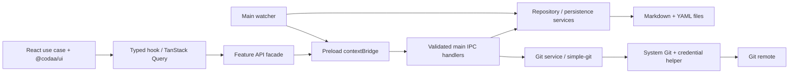

# Предложенная архитектура

Статус: draft. Базовый выбор: Electron; подробности — [ADR-0001](adr/0001-desktop-stack.md).

## Границы

| Слой | Владеет | Контракт |
| --- | --- | --- |
| Renderer | Сценариями, editor draft, selection, queries, i18n | Сериализуемые DTO, без fs/process/credentials |
| Preload | Конкретными разрешёнными методами | `openRepository`, `listCases`, `saveCase`, `gitStatus`, а не raw IPC |
| Main | OS picker, repo session, IO, watcher, Git queue, recents | Проверка отправителя, Zod input, path scope, typed errors |
| Core (если выделен) | Formats/domain, parser/serializer | Ноль React/Electron, pure tests |
| UI Kit | Доступными примитивами и tokens | @codaa/ui public exports |

## IPC

Открытие repo выполняется через main-native dialog. Main возвращает opaque session id; renderer не может подставить произвольный абсолютный path.
Каждый метод проверяет session и relative path. `realpath` и проверка symlink target предотвращают выход за repo root. Глобальный `ipcRenderer`, `require`, shell commands и Node objects не экспортируются.
Expected errors — сериализуемый Result/Problem с code, user title и field errors. Internal stack, remote credentials и arbitrary stderr не выводятся пользователю целиком.
Long operations допускают cancellation/timeout, повторный запуск защищён pending state. Методы и события типизированы отдельно, подписки имеют cleanup.

## State и persistence

TanStack Query — асинхронные repo snapshots, queries и invalidation через facade. Это локальный IPC transport, а не повод создавать HTTP server. Zustand — selection/panels/settings. Editor draft остаётся в use-case hook и не дублируется в двух stores.
Single-repo write queue сериализует saves и Git operations. Atomic writer пишет temp рядом с target и rename. Git commit/close ждут flush; failure сохраняет draft.
Watcher фильтрует self-writes, invalidates clean entities. Dirty entity при внешнем изменении получает конфликт выбора; reload не уничтожает черновик.

## Security

Main создаёт sandboxed окно: `contextIsolation: true`, `sandbox: true`, `nodeIntegration: false`; preload bundling проверяется в smoke-тесте.
Remote content не загружается в privileged окно; навигация и новые окна блокируются или разрешаются через явную политику. Внешние URLs — allowlist схем и безопасный OS handler, без исполнения строк как shell commands.
Markdown HTML/script запрещены/санитизируются. В production — CSP, запрет произвольных permissions и проверка sender frame для IPC.
Git arguments — массивы, без command interpolation. Credentials берёт Git. Git hooks и конфигурация выбранного repo требуют осознанной модели доверия: Electron sandbox не делает Git remote безопасным автоматически.

## First vertical slice

Открыть repo → main validation → pure format parser → typed DTO → tree и case read-only. Проверить отсутствие записи hashes. Затем один writer → flush → reopen → diff. Только после этого развернуть остальные CRUD/runs/Git workflows.
