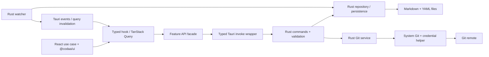

# Архитектура Tauri 2

Основа Tauri 2 выбрана пользователем; детали реализации — проект. [ADR-0001](adr/0001-desktop-stack.md).

## Границы

| Слой | Владеет | Контракт |
| --- | --- | --- |
| React WebView | Сценарии, draft, selection, queries, i18n | Serializable DTO, без fs/process/credentials |
| Invoke facade | Конкретные commands и typed errors | openRepository/listCases/saveCase/gitStatus, без generic shell API |
| Rust command layer | Session/window/payload validation | serde DTO, command permissions, typed Result |
| Rust services/domain | IO, format parsing, watcher, Git queue, recents | Pure domain и service tests, без React |
| UI Kit | Примитивы и tokens | @codaa/ui public exports |

## IPC и permissions

Folder picker — native Tauri dialog с минимальными permissions. Rust возвращает opaque repo session id; React не передаёт произвольный абсолютный repo root.
Command handlers проверяют window/webview, payload, session, repo-relative paths и canonical/symlink targets. Input structs десериализуются в serde DTO и валидируются по бизнес-правилам; ошибки и результаты имеют соответствующие TS types/runtime schemas.
Параметр типа invoke не проверяет входящий JSON автоматически: checks на обеих сторонах обязательны.

Явно объявить custom commands в AppManifest и создать allow permissions/capabilities только для доверенного окна. По умолчанию custom app commands доступны всем app windows/webviews; одних plugin permissions недостаточно. Remote API access не включается.
Ни filesystem wildcard, ни arbitrary shell execution из WebView не требуются для repo API. Node runtime и sidecar отсутствуют.

Долгие Git/IO операции выполняются вне UI thread, имеют cancellation/timeout. Tauri events содержат только необходимые DTO, frontend subscriptions очищаются.

## State и persistence

TanStack Query — repo snapshots/invalidation; Zustand — selection/panels/settings; editor draft — use-case hook. HTTP backend ради этих сценариев не создаётся.
Rust управляет repo session и single-repo operation queue. Atomic writer пишет temp рядом с target и rename; close/commit ждут flush, errors сохраняют draft.
Rust watcher фильтрует self-writes. Clean entities reload; dirty draft при внешнем изменении требует решения пользователя.

## Git

Rust service запускает системный Git executable с фиксированным repo cwd и массивом аргументов, без shell interpolation. Команды, filenames, output limits, timeout/cancellation и credential errors проверяются сервисом.
Credentials получают системный helper/SSH; Git2/libgit2 и simple-git runtime не нужны. Foreign staged files не коммитятся молча.
OS Git hooks/config выполняются системным Git: capabilities WebView не заменяют проверку доверия к repo.

## WebView и security

Production CSP, запрет произвольной навигации/remote privileges, ограниченные dialog/opener capabilities. HTML/scripts в Markdown не исполняются. Paths/URL schemes проверяются перед OS APIs.
Windows WebView2 и macOS WKWebView проверяются отдельно: одинаковый browser preview не доказывает одинаковое native поведение.
Security controls — Tauri command permissions/capabilities и Rust validation; Electron preload/contextIsolation settings здесь не применяются.

## First vertical slice

Tauri window + React/Vite/Kit → typed command → Rust read-only load → tree/case; сравнить hashes до/после открытия. Затем один Rust writer → flush → reopen → diff и parity tests. Остальные CRUD/runs/Git — следующие срезы.

## Primary sources

[Tauri commands](https://v2.tauri.app/develop/calling-rust/), [capabilities](https://v2.tauri.app/security/capabilities/), [Vite/WebView configuration](https://v2.tauri.app/start/frontend/vite/).
